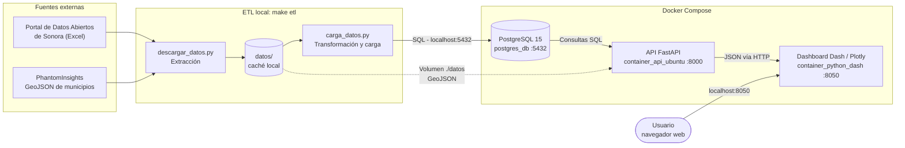

# 📊 Dashboard de Llamadas de Emergencia (C5i Sonora)

Prototipo analítico y arquitectura basada en microservicios contenerizados para el procesamiento, almacenamiento masivo y visualización interactiva de más de 500,000 registros unificados de llamadas de emergencia (tanto **procedentes** como **improcedentes**) del 9-1-1 correspondientes al primer semestre de 2026.

---

## 1. Problemática o Necesidad del Proyecto
El C5i (Centro de Control, Comando, Comunicación, Cómputo, Coordinación e Inteligencia) de Sonora centraliza un volumen masivo de llamadas operativas. El proyecto busca procesar, almacenar y analizar más de **500,000 registros** del primer semestre de 2026 —incluyendo llamadas procedentes y de mal uso o improcedentes— para identificar tendencias de incidentes, evaluar el nivel de saturación de las líneas y facilitar la toma de decisiones estratégicas y de concientización ciudadana.

---

## 2. Arquitectura
El proyecto está completamente containerizado con **Docker Compose** y se compone de 3 contenedores:

| Contenedor | Tecnología | Función |
|---|---|---|
| `postgres_db` | PostgreSQL 15 | Almacena los registros de llamadas en un volumen persistente (`pgdata`). |
| `container_api_ubuntu` | FastAPI | API RESTful que consulta PostgreSQL y entrega los datos en JSON. |
| `container_python_dash` | Dash & Plotly | Dashboard web interactivo que consume la API por HTTP. |



**Flujo general:**
1. **Extracción:** `descargar_datos.py` descarga los archivos Excel del portal de Sonora y el GeoJSON de municipios hacia `datos/` (solo los que falten).
2. **Transformación y carga:** `carga_datos.py` limpia los datos y los carga en PostgreSQL. `pipeline.py` ejecuta ambos pasos en orden (`make etl`).
3. **Servicio:** La API (FastAPI) consulta PostgreSQL y lee el GeoJSON desde el volumen compartido `./datos`.
4. **Visualización:** El dashboard (Dash) consume la API por HTTP y el usuario lo abre en `http://localhost:8050`.

---

## 3. Fuentes de Datos
* **Llamadas Procedentes 911:** [Portal de Datos Abiertos de Sonora](https://datos.sonora.gob.mx/dataset/Llamadas%20Procedentes%20911)
* **Llamadas Improcedentes 911:** [Portal de Datos Abiertos de Sonora](https://datos.sonora.gob.mx/dataset/Llamadas%20Improcedentes%20911)
* **Geometría de Municipios:** [PhantomInsights México GeoJSON (Sonora)](https://github.com/PhantomInsights/mexico-geojson/blob/main/2023/states/Sonora.json)

> **Nota:** Actualmente solo se incluyen las **llamadas improcedentes del segundo trimestre de 2026**, ya que los registros del primer trimestre presentaron inconsistencias en su estructura. Los trimestres restantes se integrarán conforme se valide su integridad.

---

## 4. Inicio Rápido
**Requisitos:** Docker, Python 3.10+ y GNU Make (incluido en WSL y la mayoría de distribuciones Linux).

```bash
cp .env.example .env   # define las credenciales de PostgreSQL
make install           # instala las dependencias del ETL
make db                # levanta PostgreSQL
make etl               # descarga los datos y los carga en PostgreSQL
make up                # levanta la API y el dashboard
```

* **Dashboard:** [http://localhost:8050](http://localhost:8050)
* **API (Swagger):** [http://localhost:8000/docs](http://localhost:8000/docs)

Consulta la [guía de instalación](docs/instalacion.md) para el detalle de cada paso, todos los comandos `make` y la solución de problemas comunes.

---

## 5. Documentación
| Documento | Contenido |
|---|---|
| [Instalación y ejecución](docs/instalacion.md) | Pasos detallados, comandos `make` y solución de problemas. |
| [Endpoints de la API](docs/api.md) | Lista de endpoints y parámetros de filtrado. |
| [Dashboard](docs/dashboard.md) | Filtros y descripción de cada visualización. |
| [Base de datos](docs/base-de-datos.md) | Esquema de las tablas y reglas de normalización. |

---

## 6. Estructura del Proyecto
```text
proyecto-c5i/
├── datos/                  # Generado por `make etl` (excluido de git)
├── api/                    # API FastAPI (Dockerfile, main.py)
├── dashboard/              # Dashboard Dash (Dockerfile, app.py)
├── docs/                   # Documentación detallada
├── etl/
│   ├── descargar_datos.py  # Extracción
│   ├── carga_datos.py      # Transformación y carga
│   └── pipeline.py         # Orquesta ambos pasos
├── .env.example
├── Makefile
├── requirements.txt
└── docker-compose.yml
```
